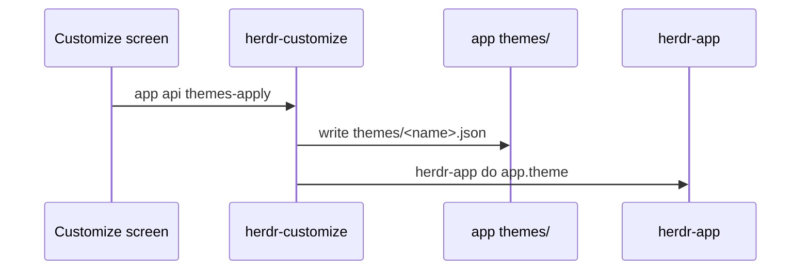

# PR

Every pull request body here follows
[.github/pull_request_template.md](../../../.github/pull_request_template.md).
Read it, fill each section as below, and delete its HTML comments. Keep the
`Before merging` checklist, ticking only what is true.

Skip preambles and keep prose brief. Use the terms the code and README use:
screen, page, theme, palette, mod, layout, popup, program, key and binding.
Write in English, whatever language the request came in. Add no
"Generated with" line or other attribution, for the same reason
[AGENTS.md](../../../AGENTS.md) forbids a co-author trailer in a commit.

Opening a pull request starts CI, and Actions minutes are limited: open one
only when the user asks.

## Summary

Pick the smallest view that makes the key point clear, and put a line of why
beside it. Link the issue with `Closes #N`, or `Related: #N` when the issue
stays open after this pull request.

- Logic or an algorithm as pseudocode:

```text
on(app api themes-apply)
  write themes/<name>.json in the app home
  herdr-app do app.theme
```

- Runtime control flow as a call tree:

```text
app screen task()
  page.applyTheme()
    call("themes-apply")
      write themes/<name>.json
      herdr-app do app.theme
```

- File responsibility or a broad refactor as a shallow file tree:

```text
src/
├── app/        # app-home reads, writes and JSON API
├── theme/      # bundled palette loading
└── testenv.rs  # isolated app test sandbox
app/
└── mods/       # the Customize screen
```

- Component interaction or data flow with Mermaid:



- A `diff` when the point is what changes and the surrounding shape already
  exists. Match the diff shape to the topic:

```diff
app api themes-apply
  write themes/<name>.json
- do not show the selected palette
+ herdr-app do app.theme
```

- The whole block when most of it is new, when omitted context would hide
  ownership or order, or when the reader needs a copyable target shape.

Place each visual next to the short text it supports. Keep only the calls,
files, fields, states and boundaries needed to make the point. One view is
usually enough, several are sometimes needed, all of them never are.

## Evidence

Concrete evidence the change works: a before and an after.

- The Customize screen before and after is S-tier when the change is visible:
  a screenshot or a real app run. Describe it in text when neither is to hand.
- Execution-based evidence is A-tier: the exact test that failed and now
  passes, named, with its output; a run on Windows or Linux for platform code.
- `cargo test` and clippy green are the floor, not evidence. Say them only in
  the checklist.

## Merge Danger

**Door:** `one-way` or `two-way`. A two-way door is cheap to walk back. Usual
one-way doors are a write to the user's app home or herdr-core `config.toml`,
a mod installed or removed, and a release asset name that
`scripts/fetch-or-build.*` already depends on.

**Blast Radius:** one word, then a line of what could break and for whom:
the user's app home, Windows or Linux only, a Herdr app version, or installs
without Cargo.

## Commit scopes

Use `app`, `themes`, `mods`, `keys`, `proc`, `deps`, `docs` or `ci` as the
scope in Conventional Commit subjects.
