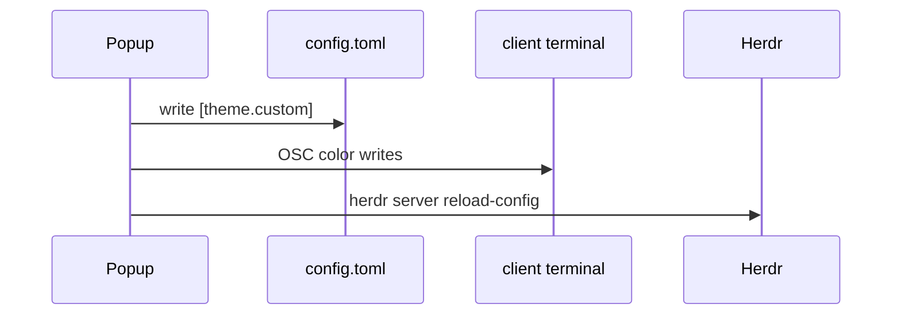

# PR

Every pull request body here follows
[.github/pull_request_template.md](../../../.github/pull_request_template.md).
Read it, fill each section as below, and delete its HTML comments. Keep the
`Before merging` checklist, ticking only what is true.

Skip preambles and keep prose brief. Use the words the code and the README
use: popup, page, theme, palette, client, sync, setting, binding, plugin,
action. Write in English, whatever language the request came in. Add no
"Generated with" line or other attribution, for the same reason
[AGENTS.md](../../../AGENTS.md) forbids a co-author trailer in a commit.

Opening a pull request starts CI, and Actions minutes are limited: open one
only when the user asks.

## Summary

Pick the smallest view that makes the key point clear, and put a line of why
beside it. Link the issue with `Closes #N`, or `Related: #N` when the issue
stays open after this pull request.

- Logic or an algorithm as pseudocode:

```text
on(apply theme)
  write [theme.custom], keeping a daily backup of config.toml
  record the selection beside it
  recolor each client terminal, best effort
  herdr server reload-config, best effort
```

- Runtime control flow as a call tree:

```text
ui::run
  App::key
    Page::key
      Ctx::spawn
  App::dispatch(Msg)
    Page::update
```

- File responsibility or a broad refactor as a shallow file tree:

```text
src/
├── ui/         # the popup: event loop, Msg, Ctx and one file per page
├── theme/      # palettes, [theme.custom] writes, apply and sync
└── terminal/   # finding clients and recoloring them, per OS
```

- Component interaction or data flow with Mermaid:



- A `diff` when the point is what changes and the surrounding shape already
  exists. Match the diff shape to the topic:

```diff
 theme::apply_theme
   write_custom_block
   fsutil::atomic_write(applied_file)
-  sync_terminal_colors
+  if HERDR_CUSTOMIZE_CLIENT_PID is set
+    sync_terminal_colors(that client)
   herdr::reload
```

- The whole block when most of it is new, when omitted context would hide
  ownership or order, or when the reader needs a copyable target shape.

Place each visual next to the short text it supports. Keep only the calls,
files, fields, states and boundaries needed to make the point. One view is
usually enough, several are sometimes needed, all of them never are.

## Evidence

Concrete evidence the change works: a before and an after.

- The popup before and after is S-tier when the change is visible there: a
  screenshot, or the screen as text from the UI test driver. Describe it in
  text when neither is to hand.
- Execution-based evidence is A-tier: the exact test that failed and now
  passes, named, with its output; a run on Windows or Linux for platform code.
- `cargo test` and clippy green are the floor, not evidence. Say them only in
  the checklist.

## Merge Danger

**Door:** `one-way` or `two-way`. A two-way door is cheap to walk back. Here
the usual one-way doors are a write to the user's `config.toml` that a revert
cannot take back, colors pushed to their terminals, a plugin installed or
removed, and a release asset name or version that `scripts/fetch-or-build.*`
already depend on.

**Blast Radius:** one word, then a line of what could break and for whom:
the user's config, Windows or Linux only, a Herdr version, remote clients over
SSH, installs without cargo.
