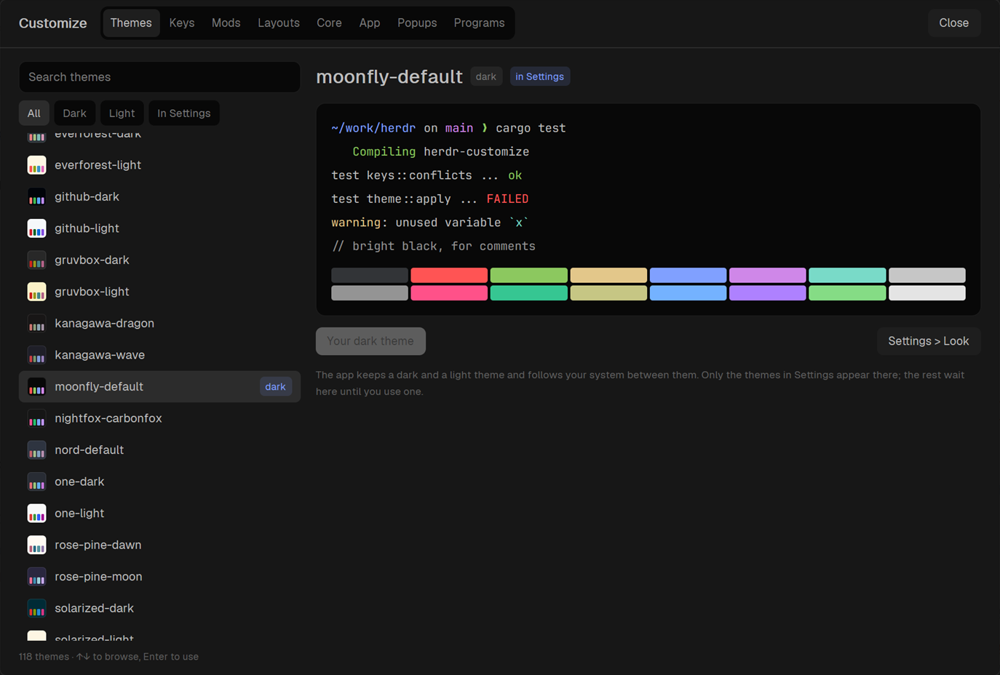
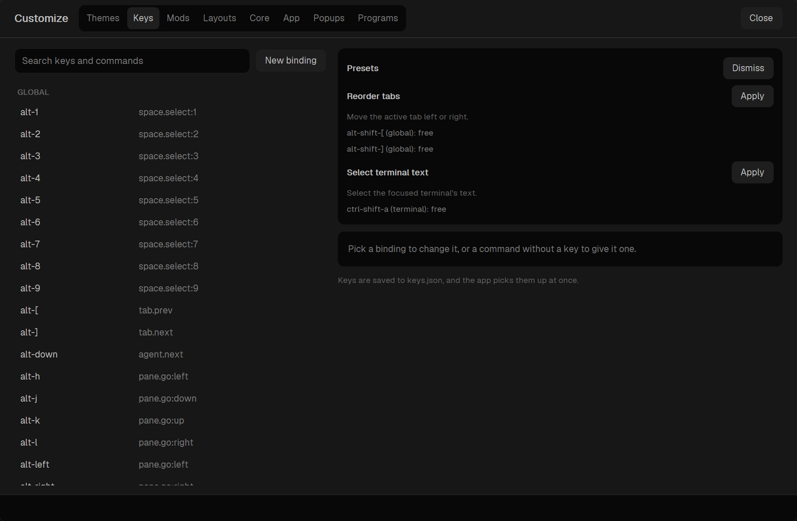
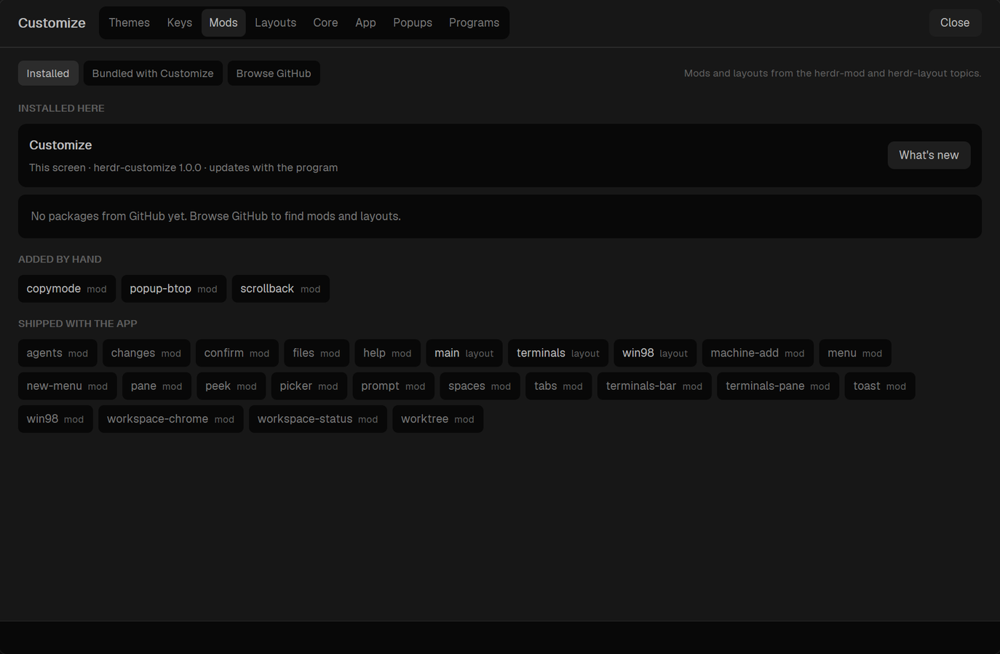
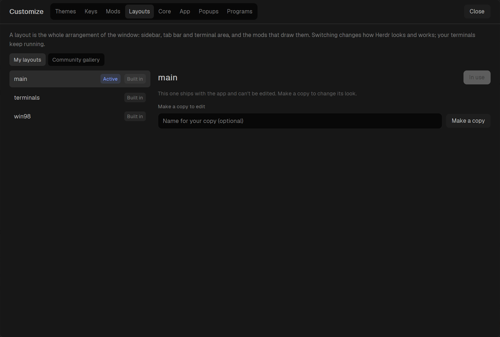
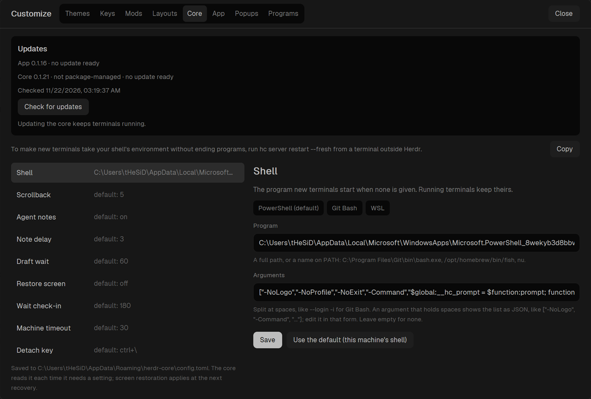
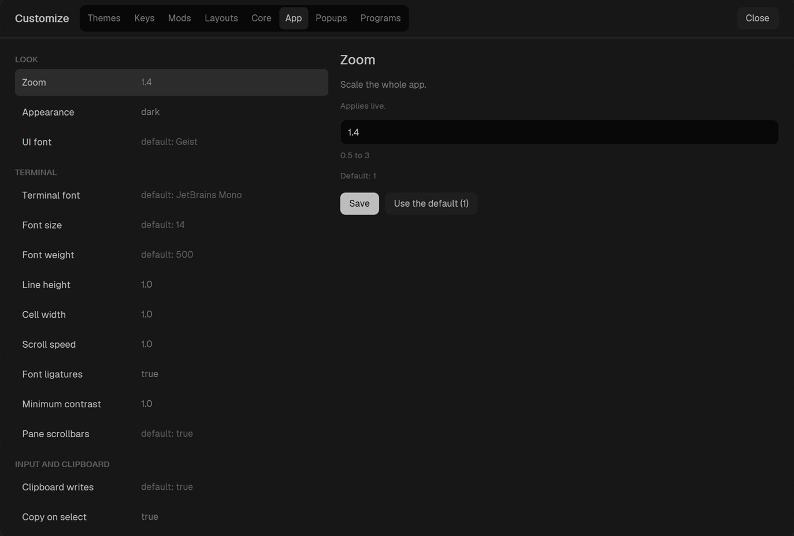
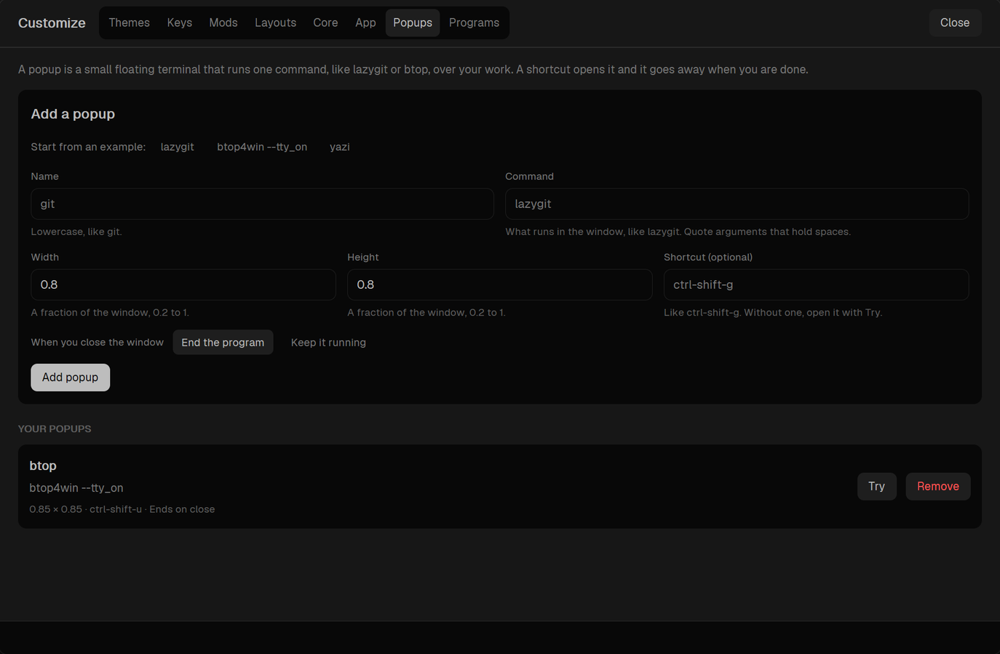
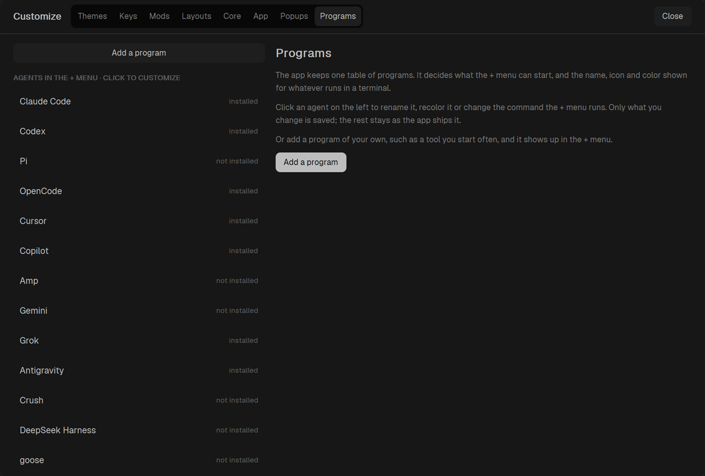

# herdr-customize

herdr-customize adds a Customize screen to the [Herdr app](https://herdr.dev) for themes, keys, mods, layouts, core and app settings, popups, and programs. It runs on Linux, macOS and Windows.

## Pages

| | |
|---|---|
| **Themes**: over 100 palettes with a live preview; one click makes one your light or dark theme.<br> | **Keys**: every binding, a form to change or add one, and presets for common keys.<br> |
| **Mods**: what is installed, the mods bundled with Customize, and Browse for herdr-mod repositories on GitHub.<br> | **Layouts**: switch, copy and style layouts, or install one from the community gallery.<br> |
| **Core**: herdr-core's shell, scrollback and agent settings, and update checks.<br> | **App**: the app's look, terminal and clipboard settings.<br> |
| **Popups**: a key that opens a command such as lazygit or btop in a floating terminal.<br> | **Programs**: rename, recolor or change the agents in the + menu, or add your own.<br> |

See [the app guide](docs/app.md) for details.

## Install

Clone the repository, fetch or build its binary, then install the screen:

```sh
git clone --depth 1 https://github.com/wapenshaw/herdr-customize ~/.local/share/herdr-customize
cd ~/.local/share/herdr-customize
sh scripts/fetch-or-build.sh
target/release/herdr-customize app install
```

On Windows, run `scripts\fetch-or-build.ps1` in PowerShell instead. The screen opens with **ctrl+shift+y** (**cmd+shift+y** on macOS). See [installing](docs/install.md) for requirements, updates and removal.

## Herdr TUI

The TUI plugin was retired in 1.0.0. Its last release was v0.10.0; pin it with `herdr plugin install wapenshaw/herdr-customize --ref v0.10.0`.

## Development

[Development](docs/development.md) · [Contributing](CONTRIBUTING.md)

[MIT License](LICENSE).
