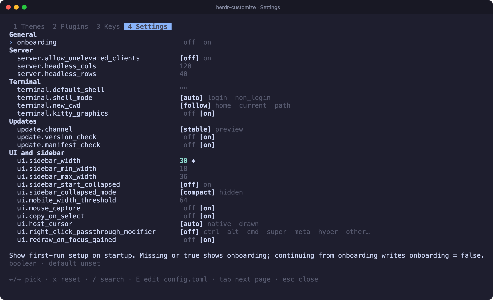
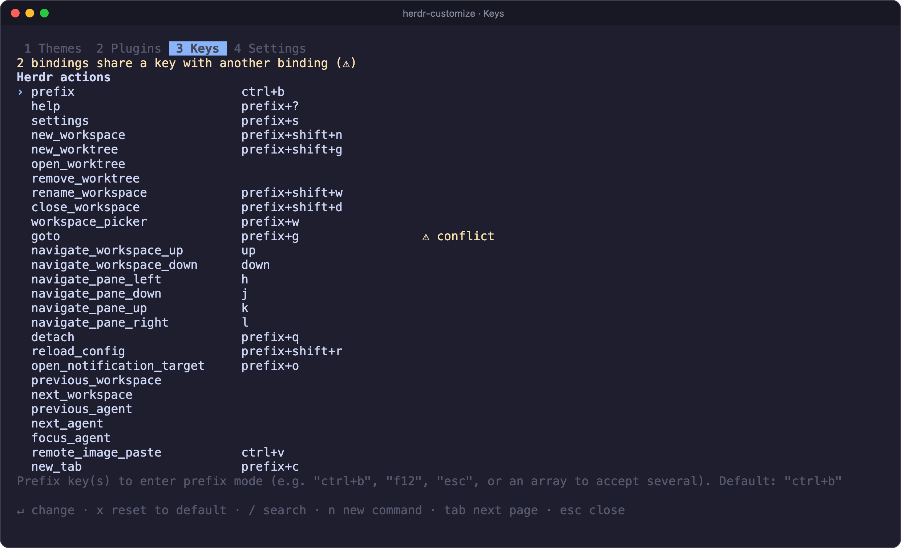
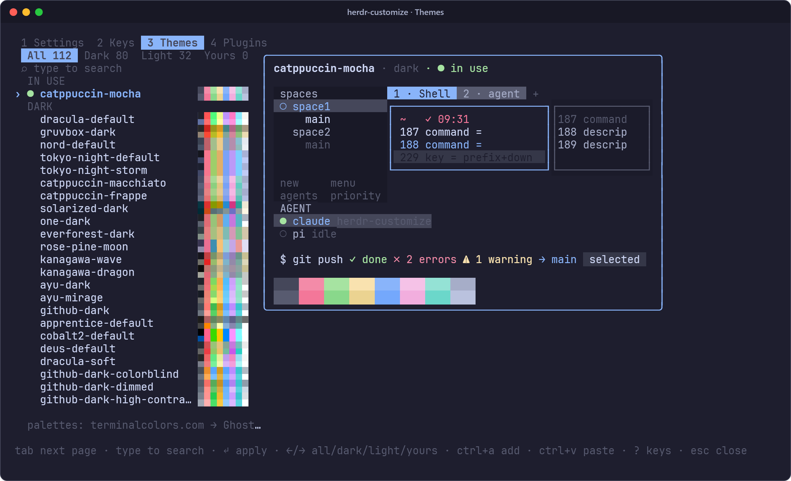
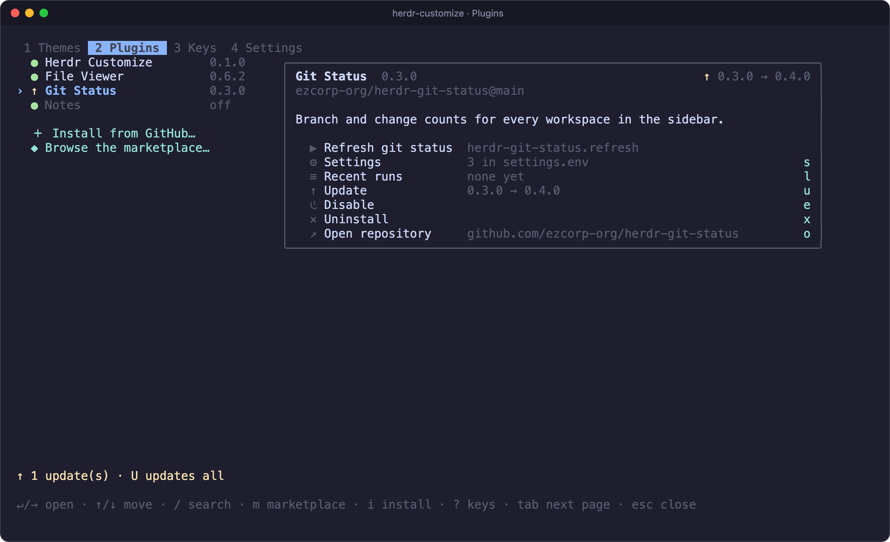

# herdr-customize

Settings, key bindings, themes and plugins for [Herdr](https://herdr.dev), in
one popup instead of hand-editing `config.toml`. Runs on Linux, macOS and
Windows.



## Features

- **Settings**: every setting your Herdr version has, grouped as in its docs,
  with the allowed values right on the row. Flip through them with ←/→.
- **Keys**: Herdr's actions, your custom commands and plugin actions that
  have no key yet, in one list. Press a key to record it; conflicts are
  flagged before you save.
- **Themes**: 112 palettes with a live preview. One key recolors Herdr and
  the terminal it runs in. Add your own from the clipboard.
- **Plugins**: update, install, enable, remove and configure your plugins,
  read their logs, and browse the marketplace.
- **Safe edits**: your comments and layout stay put. Herdr checks every change
  before it is written, the original is backed up daily, and Herdr reloads
  by itself.

| Keys | Themes | Plugins |
| --- | --- | --- |
|  |  |  |

## Install

```bash
herdr plugin install wapenshaw/herdr-customize
herdr plugin action invoke bind --plugin herdr-customize
```

The first command installs the prebuilt binary for your platform. The second
binds `prefix+t` to the popup. [Installing](docs/install.md) covers other
keys, binding by hand and building from source.

## Use

- **prefix+t** opens the popup.
- **Tab** and **Shift+Tab** switch pages, as do **1** to **4**.
- **?** lists every key on a page, and **Esc** closes the popup.

To update, run `herdr plugin update herdr-customize` or update it from its own
Plugins page.

Coming from herdr-theme-picker or Plugin Manager? This plugin replaces both;
[here is how to switch](docs/install.md#coming-from-herdr-theme-picker-or-plugin-manager).

## Documentation

- [Installing](docs/install.md): platforms, key bindings, updating and the
  command line.
- [Using the popup](docs/guide.md): every page and its keys.
- [Themes](docs/themes.md): where a theme applies, terminal colors,
  `herdr --remote` and adding palettes.
- [Configuration and state](docs/configuration.md): how edits, checks,
  backups and locks work.
- [For plugin authors](docs/plugin-authors.md): describe your settings with
  `config-schema.json`.
- [Development](docs/development.md) and [Contributing](CONTRIBUTING.md).

## Ideas

Sidebar row layouts with a preview, saved pane layouts, tab bar and window
title builders, sounds and notifications, and restoring config backups.

## Credits

- The Themes page started as
  [qintmb/herdr-theme-picker](https://github.com/qintmb/herdr-theme-picker).
  Thanks to its contributors.
- The Plugins page is a port of
  [speardragon/herdr-plugin-manager](https://github.com/speardragon/herdr-plugin-manager)
  (MIT).

## License

MIT; see [LICENSE](LICENSE).
