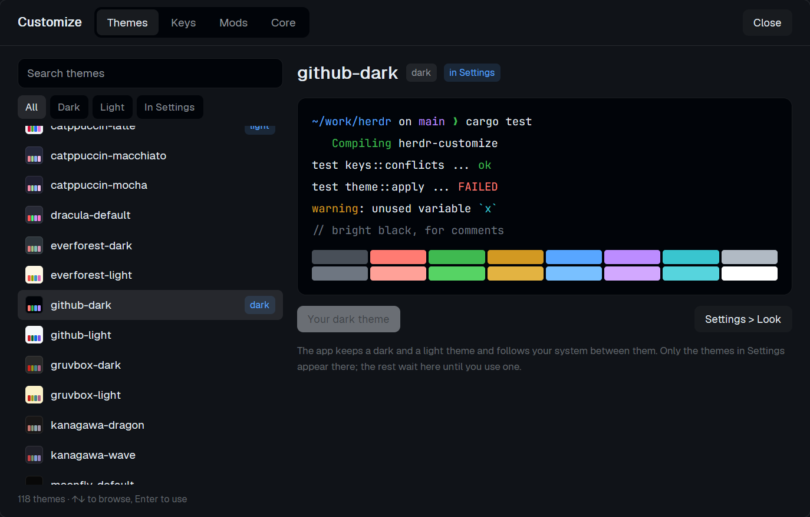
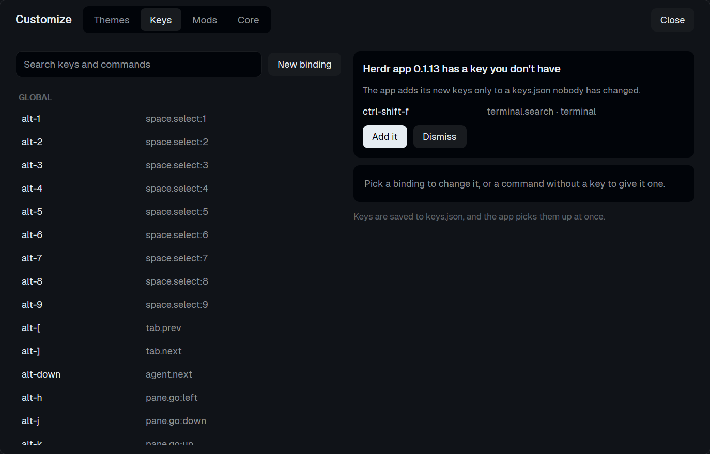
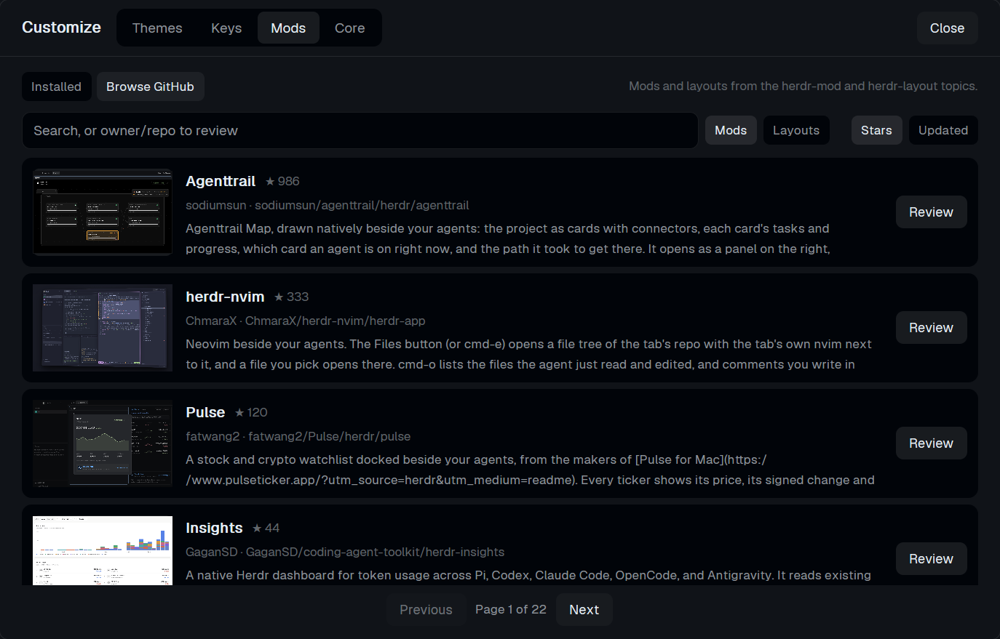
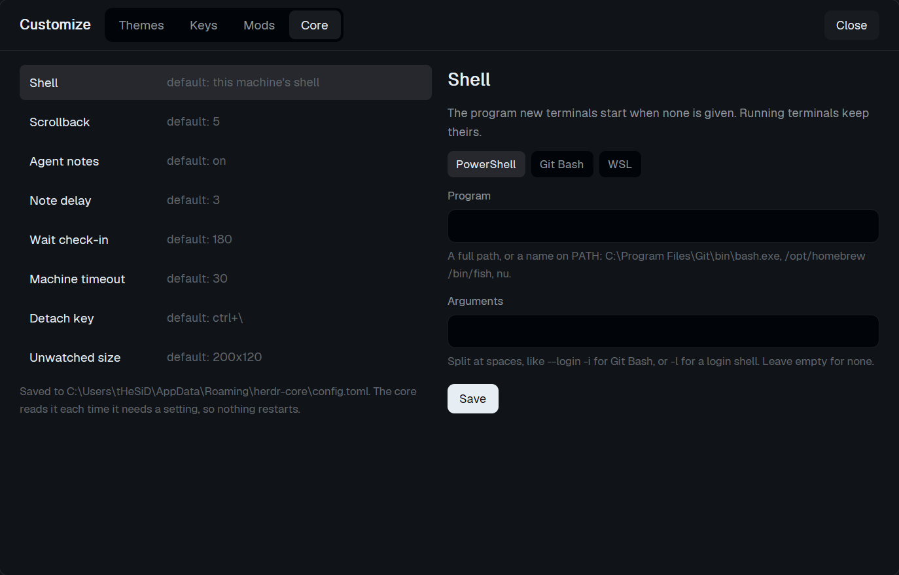

# Customize for the Herdr app

Customize Herdr from one screen: pick a theme with a live preview, change
your keybindings and get the new ones app updates leave out, find, review and
install mods and layouts from GitHub, and set herdr-core's shell, scrollback
and timeouts. No config files to edit.

| Themes | Keys | Mods | Core |
| --- | --- | --- | --- |
|  |  |  |  |

## Add it

Ask an agent running in the app:

```text
Read ~/.config/herdr-app/AGENTS.md, then add this mod: github.com/wapenshaw/herdr-customize/tree/main/app
```

The mod is the screen of the herdr-customize program and does nothing
without it, so the [recipe](RECIPE.md) has the agent set up the program
rather than copy these files. To do it by hand:

```sh
git clone --depth 1 https://github.com/wapenshaw/herdr-customize ~/.local/share/herdr-customize
cd ~/.local/share/herdr-customize
sh scripts/fetch-or-build.sh          # Windows: powershell -File scripts/fetch-or-build.ps1
target/release/herdr-customize app install
```

The [guide](../docs/app.md) covers each page and the commands.
