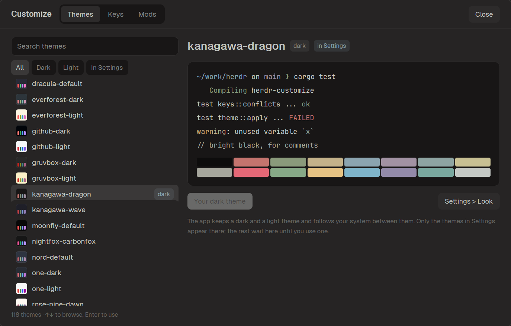

# Customize

Customize Herdr from one screen: pick a theme with a live preview, change
your keybindings and get the new ones app updates leave out, find, review and
install mods and layouts from GitHub, and set herdr-core's shell, scrollback
and timeouts. No config files to edit.



## Before you add it

This mod is the screen of the herdr-customize program and does nothing
without it, so set up the program instead of copying the files. Tell the
person first: the mod runs that program, which searches GitHub, clones the
repositories they review, and writes the app's `themes/`, `keys.json`,
`mods/` and `layouts/`, and herdr-core's `config.toml`.

```sh
git clone --depth 1 https://github.com/wapenshaw/herdr-customize ~/.local/share/herdr-customize
cd ~/.local/share/herdr-customize
sh scripts/fetch-or-build.sh          # Windows: powershell -File scripts/fetch-or-build.ps1
target/release/herdr-customize app install
```

The script downloads the release binary for that version, or builds it with
`cargo`; the palettes stay beside it in the checkout. `app install` writes
this mod with the program's place filled in, binds the key unless it is
taken (`app install alt-shift-c` picks another), writes 26 palettes to
`themes/` and runs `herdr-app check` on the mod. It never replaces a key.

## What you see

An overlay of 86% of the window each way, in the theme's `popover` color.

- **Header**, 52px: "Customize", the four pages as a segmented control, the
  running task's name while one runs, and **Close**.
- **Themes**: on the left, 300px wide, a search box, the filters All, Dark,
  Light and In Settings, and a list of 34px rows with a swatch of the
  palette, its name and a `dark` or `light` badge on the two in use. On the
  right, the palette's name, a terminal drawn in its colors and the app's
  terminal font, its 16 colors, and **Use as dark/light theme**, **Add to
  Settings only** and **Settings > Look**.
- **Keys**: on the left, 420px wide, `keys.json` by section, then the
  commands that no key runs. On the right, a form: Key with **Record**,
  Action with the command's description, Section, then errors in red,
  warnings in amber, and **Save** (**Replace** when another binding holds the
  key) and **Unbind**. With no binding picked, a card lists the keys the
  app's version ships that `keys.json` lacks, with **Add them** and
  **Dismiss**.
- **Mods**: Installed (packages with **Check for update** and **Remove**,
  mods added by hand, the app's own) and Browse GitHub (a search box, Mods
  or Layouts, Stars or Updated, 20 repositories a page, one card per
  package: its picture, recipe title, stars, first paragraph and
  **Review**). A review shows, on the left, the summary, picture and recipe;
  on the right, what the package adds, what its code reaches, the keys it
  would take, **Install**, and the agent line with **Copy**.
- **Core**: on the left, 420px wide, herdr-core's settings, each with its
  value or its default, and the file's path. On the right, the setting's
  title and description, then chips of the shells found here with Program
  and Arguments for Shell, On and Off for Agent notes, or one input, then
  **Save** and **Use the default** when it is set.
- A strip at the bottom for the last notice, green, or error, red.

## How it behaves

- It opens with the keyboard in the search box and the theme in use
  selected and scrolled into view.
- **Tab** and **Shift+Tab** switch pages. **↑**/**↓**, **PageUp** and
  **PageDown** browse themes and **Enter** uses one. **Esc** leaves a
  review, then closes.
- Using a palette that is not in Settings writes its theme file, then runs
  `app.theme` 400ms later.
- One change runs at a time; the buttons dim until it ends.
- The key form checks on every edit; a key that another binding holds says
  so before saving.
- Without the program's place filled in, it looks in
  `~/.local/share/herdr-customize/target/release`, then on `PATH`, and
  otherwise shows the setup steps, or names a binary too old to answer.

## Built from

- `mods/herdr-customize/main.js`: one gpui-kit `View`; `h_flex`, `v_flex`,
  `Input` and `v_virtual_list` from gpui-base, `uniform_list` for the keys.
- `mod.json`: `"place": "none"`, an overlay of `0.86` by `0.86`: sizes up
  to 1 are shares of the window.
- `herdr`: `exec`, `home`, `appHome`, `theme`, `themes`, `settings`, `keys`,
  `commands`, `run`, `props`, `closeOverlay`, `window`.
- Commands: `app.theme`, `app.settings`, `mod.open`, `layout.switch`.
- Every read and write is `herdr-customize app --home <appHome()> api
  <command>`, which prints JSON: `palettes`, `theme-write`, `key-check`,
  `key-set`, `key-remove`, `key-shipped`, `key-shipped-add`,
  `key-shipped-dismiss`, `packages`, `market`, `review`, `install`,
  `remove`, `core`, `core-set`. `src/app/api.rs` in this repository is the reference.

## Watch out

- `herdr-app check` has no window, and a program started there keeps the
  checker's output open: start nothing while `window()` is null.
- Tab moves the app's focus unless bound: bind it to actions under the
  mod's own key context. Focus only an input that is drawn, else the root.
- `track_scroll` does nothing on `uniform_list`; the theme list is a
  `v_virtual_list` so it can scroll to the selection.
- Settings > Look draws every theme file and fails with all 112 palettes
  there, so only 26 are written up front.
- A fixed overlay size is not shrunk to a small window, whose header then
  falls outside it.
- The app's `PATH` can be shorter than a shell's.
- herdr-core treats a `config.toml` it cannot read as no file, so check each
  value before writing it.
- The app upgrades only a `keys.json` that is byte for byte one it shipped;
  any edit, this mod's own key included, stops its new keys arriving.

## Done when

- The key opens it and typing filters the themes at once.
- Tab goes Themes, Keys, Mods, Core and back to Themes from every page, and
  Shift+Tab the other way.
- Enter on a theme changes the app's theme for that slot.
- Picking `alt-1` shows "Show a space (by position or id)." under Action.
- `owner/repo` and Enter on Browse GitHub shows its review.
- `herdr-app check ~/.config/herdr-app/mods/herdr-customize` passes.
