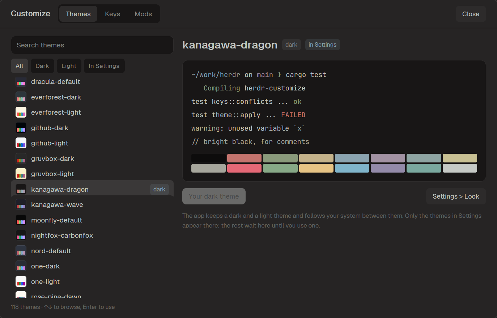
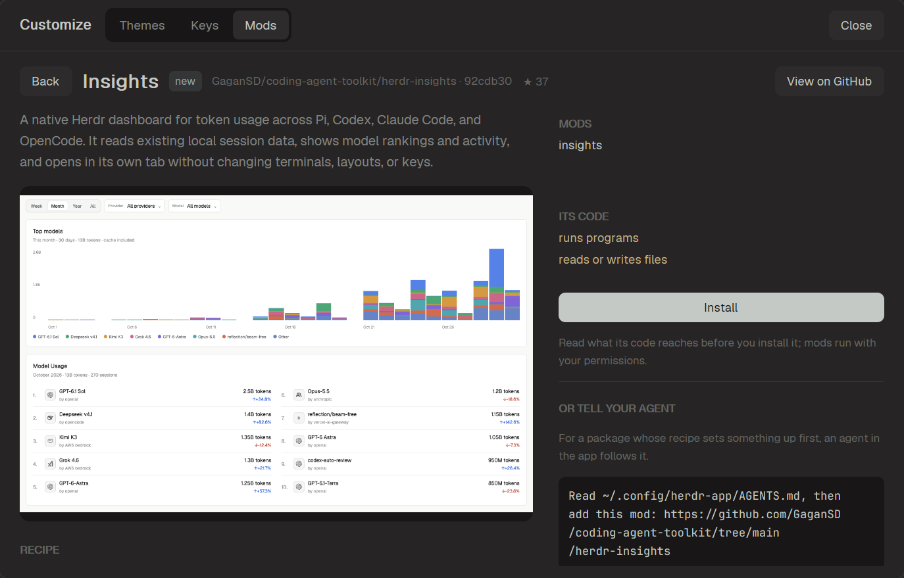
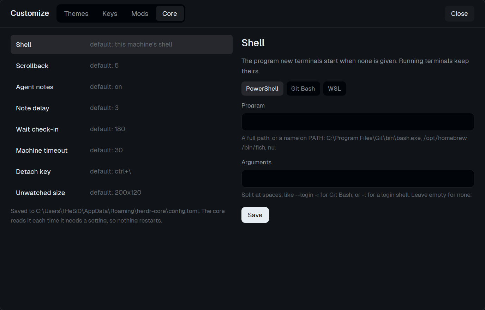

# The Herdr app

The Herdr app (`herdr-app`) is a desktop window over terminals that
herdr-core runs. It is separate from Herdr in the terminal: it keeps its
own themes, keys and mods in its own folder, and it follows edits to those
files live. herdr-customize writes its palettes as the app's themes and
adds a screen to the app with four pages: Themes, Keys, Mods and Core. It
never touches Herdr's `config.toml` from there.

| Themes | Keys | Mods |
| --- | --- | --- |
|  |  |  |

## Set it up

The easiest way is to ask an agent running in the app, as for any mod on
herdr.dev:

```text
Read ~/.config/herdr-app/AGENTS.md, then add this mod: github.com/wapenshaw/herdr-customize/tree/main/app
```

Its [recipe](../app/RECIPE.md) has the agent set up the program rather
than copy the mod's files, since the screen does nothing without it.

By hand: herdr-customize needs its folder, not just the binary, because the
palettes live beside it. Clone this repository to
`~/.local/share/herdr-customize`, run `scripts/fetch-or-build.sh` there (or
`.ps1` on Windows), which puts the binary in `target/release`, then run
`target/release/herdr-customize app install`. If Herdr in the terminal
already has the plugin, its binary works too.

`app install` writes 26 well-known palettes, and the ones you added in
Herdr, to the app's `themes` folder. It also writes a mod,
`mods/herdr-customize`, that draws the screen with the app's own controls
and colors, and binds **ctrl+shift+y** (**cmd+shift+y** on macOS) to it.
There, **Tab** and **Shift+Tab** switch pages and **Esc** closes it. A key already in
use is never taken: pass another one, as in
`herdr-customize app install alt-shift-c`. Run it again after moving the
binary; it updates the mod and keeps the key.

The mod is also published on its own in [app/](../app), so it can be added
like any other. A copy that `app install` did not write looks for the
binary in `~/.local/share/herdr-customize`, then on `PATH`, and shows the
steps above when there is none.

The app's folder is `HERDR_APP_HOME`, else `$XDG_CONFIG_HOME/herdr-app`,
else `~/.config/herdr-app` (on Windows, under your user profile). The app
must be installed; herdr-customize finds `herdr-app` on `PATH` or where its
installers put it, or at `HERDR_APP_BIN`.

## Themes

Every palette, with a preview of a terminal in its colors. Type to filter,
**↑**/**↓** to browse and **Enter** to use one. The app keeps a dark and a
light theme for each layout and shows the one that matches **Appearance**,
so a light theme picked while the system is dark shows only once it turns
light; the page says so.

The core hands the new colors to the programs in the app's terminals, and
ones that follow the terminal's colors, such as Neovim, change with it.

The app's own **Settings > Look** lists the files in its `themes` folder.
Settings draws every one each time it opens, and with all 112 palettes it
fails with "This view could not be rendered", so herdr-customize writes only
some there; using any other palette writes its file first.

A theme from herdr-customize recolors the whole window. The app derives its
backgrounds, accent and agent colors from any theme, but draws panel text
in neutral grey; these themes give the sidebar, tabs and menus the
palette's own text color, with muted and dim shades of it that stay
readable. An accent or sidebar color you set for a palette on Herdr's Themes
page comes along.

`app themes` writes the set again after you add a palette in Herdr. A theme
file you edited, or one herdr-customize did not write, is left alone;
`--force` replaces it. The record is `data/herdr-customize/themes.json`.

## Keys

`keys.json` by section, then the app's commands that no key runs yet. Pick
a binding to change or unbind it, or a command to give it a key; **Record**
takes the next key you press. **New binding** starts an empty one.

A section decides where a key counts: `terminal` wins over `layout:<name>`,
which wins over `global`, and `mod:<name>` counts while that mod has focus.
**◆** marks a key another section also binds. The form refuses a key the app
cannot read and an action it does not know, and warns about a key that
types text, one programs rely on (ctrl+c, d, l, r, w, a, e, u, k, z and [),
ctrl+alt, which is AltGr on Windows, and a key a section that wins already
takes, as `terminal` takes ctrl+shift+c to copy. A binding with typed arguments, such as
`{"command": "layout.resize", "args": {"id": "sidebar", "px": 240}}`, shows
and is edited as that JSON. Saving a key another
binding holds replaces that binding, and the form says which before you
save. `app install` refuses a key a section that wins already takes.

The app adds the keys a new version brings only to a `keys.json` nobody has
changed, and `app install` changes it to add its own key. So the page reads
the keys file the installed app version shipped with from the app's
repository, and offers the keys that yours lacks, under **Add them** and
**Dismiss**. A shipped key isn't offered if your file already uses its key in
that section or binds its action to another key, so a key you moved or
removed stays as you left it. Offline, it offers nothing.

## Mods

**Installed** lists the packages installed from here, the mods and layouts
added by hand, and the ones the app ships; a layout opens on click.
**Browse GitHub** searches repositories tagged `herdr-mod` or
`herdr-layout`, by stars or by last update, and lists each package in them
the way herdr.dev's Mods page does: by its recipe's title, with its first
paragraph and its `preview.png`. A package with a layout is listed under
Layouts only, even when it brings mods for it. To find the packages, it
clones each repository's file list alone (`git clone --filter=blob:none`)
and reads only the recipes and pictures; that takes a few seconds per page
the first time, and `data/herdr-customize/browse.json` keeps the result
until the repository is pushed to. Type `owner/repo`, or
`owner/repo/folder` for one package of a repository that holds several, or
paste its GitHub link, such as the one herdr.dev gives, and press **Enter**
to review it directly. A link to a branch other than the default one is
refused, since installs and updates read the default branch.

Nothing is installed before a review, which shows the package as herdr.dev
does: its title, picture and recipe, **View on GitHub**, and the line to give
an agent in the app instead, with **Copy**. Beside them, what it adds: its
mods, layouts, themes and keys, and whether its code runs programs, reaches
the network or reads and writes files. Pictures are kept in
`data/herdr-customize/previews/`.



A name another package or you already use stops the install. A key you
already use stays yours unless you tick **Give these keys to the package**.
The install takes the commit you reviewed, or refuses if the repository
moved on since, and each mod then goes through the app's own check.

This screen is listed first, as Customize with the program's version; it
updates with herdr-customize rather than as a package. **Check for update**
reviews a package again; one with files you changed
asks first. **Remove** takes it away with the keys it added; files you
changed stay. The record is `data/herdr-customize/packages.json`. Downloads
use `git`.

## Core

The terminals live in herdr-core, which keeps its own settings in
`config.toml` beside its other files: `%APPDATA%\herdr-core` on Windows,
`~/.config/herdr-core` elsewhere, or under `XDG_CONFIG_HOME` when it is set.
The Core page edits that file: the shell new terminals start, scrollback,
agent notes and their delay, how long `hc wait` and other machines get, the
key that leaves `hc attach`, and the size of a terminal nobody is watching.



The core reads the file each time it needs a setting, so a change takes
effect without a restart, and running terminals keep their shell. A file it
cannot read means all its defaults, so the page checks each value as the
core would and refuses one it would not take; a file that is already broken
is shown and left alone. **Shell** offers the shells found on this machine:
PowerShell, Git Bash, Nushell and WSL on Windows, or those in `/etc/shells`.
PowerShell is the core's default there, with a hook that lets the core follow
the shell's folder, so picking it clears the setting rather than naming it. `socket` is left out: moving it leaves
clients looking for the core in the old place. The page edits this machine's
file only; the others keep theirs.

## Commands

```sh
herdr-customize app install [key]          # the themes, the mod and its key
herdr-customize app themes [--force]       # the palettes to the app again
herdr-customize app apply dracula-default  # show a theme in the app
herdr-customize app reset                  # back to graphite and paper
```

`--home DIR` before the command picks another app folder; the screen passes
the app's own. `apply` and `reset` need the app open. The screen reads and
writes through `herdr-customize app api`, which prints JSON and is not meant
to be typed.
