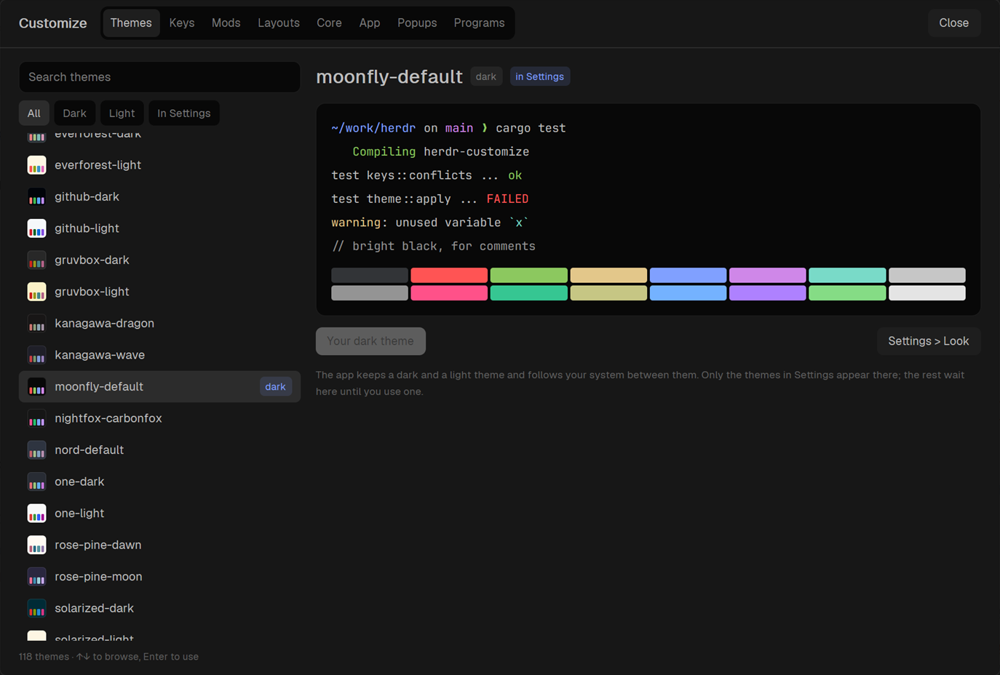
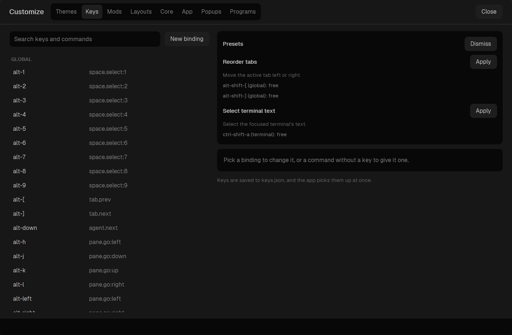
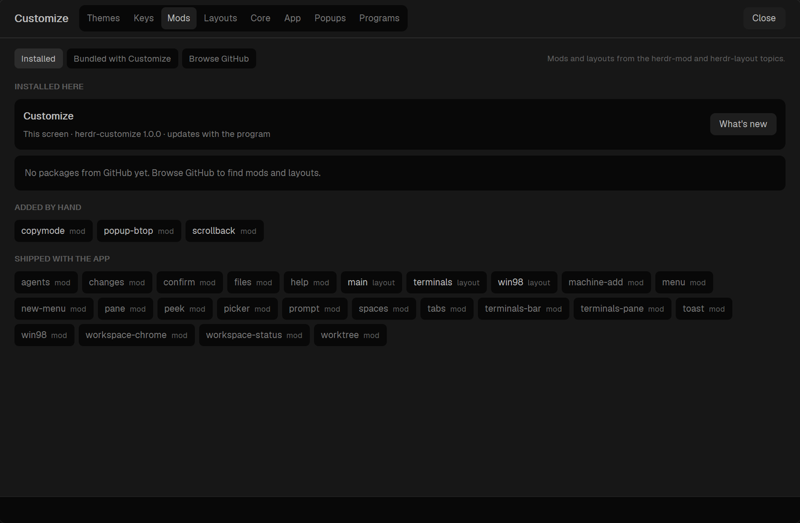
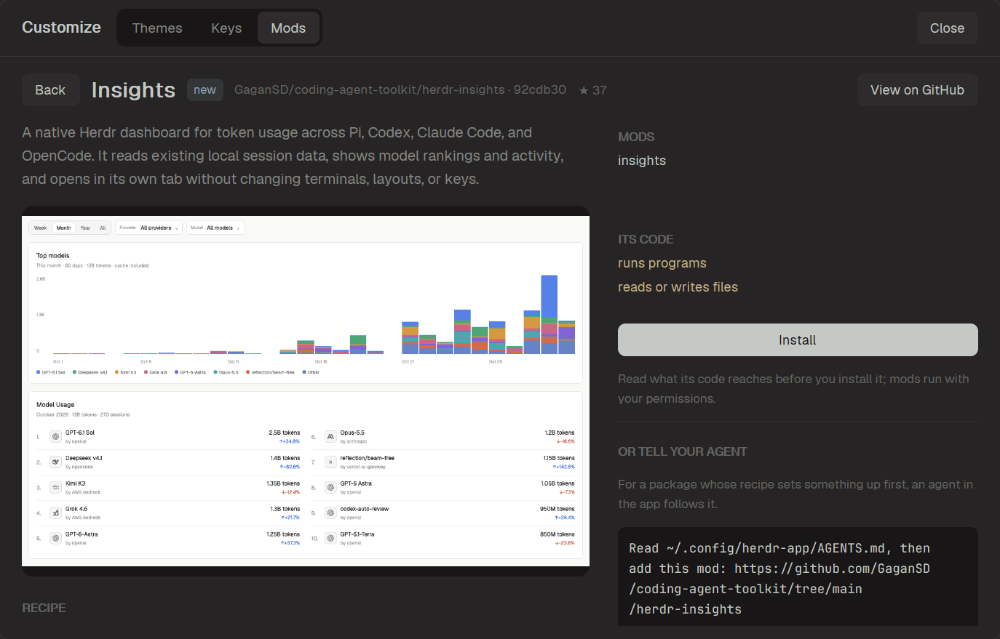
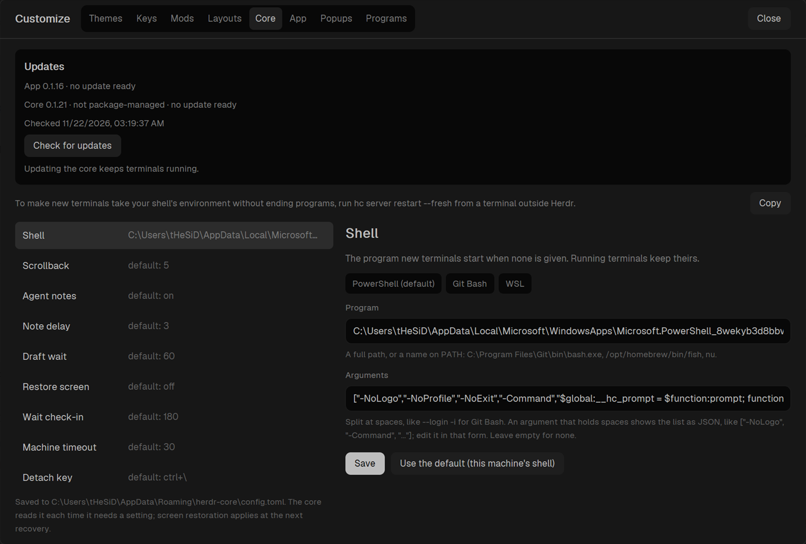

# The Herdr app

The Herdr app (`herdr-app`) is a desktop window over terminals that
herdr-core runs. It is separate from Herdr in the terminal: it keeps its
own themes, keys and mods in its own folder, and it follows edits to those
files live. herdr-customize writes its palettes as the app's themes and
adds a screen to the app with eight pages: Themes, Keys, Mods, Layouts, Core,
App, Popups and Programs. It
never touches Herdr's `config.toml` from there.

| Themes | Keys | Mods |
| --- | --- | --- |
|  |  |  |

## Set it up

The easiest way is to ask an agent running in the app, as for any mod on
herdr.dev:

```text
Read ~/.config/herdr-app/AGENTS.md, then add this mod: github.com/wapenshaw/herdr-customize/tree/main/app
```

Its [recipe](../app/RECIPE.md) has the agent set up the program rather
than copy the mod's files, since the screen does nothing without it.

By hand: herdr-customize needs its folder, not just the binary, because the
palettes live beside it. Clone this repository to
`~/.local/share/herdr-customize`, run `scripts/fetch-or-build.sh` there (or
`.ps1` on Windows), which puts the binary in `target/release`, then run
`target/release/herdr-customize app install`. The palettes live beside the
binary in the checkout.

`app install` writes the featured bundled palettes, including palettes
herdr-customize wrote before, to the app's `themes` folder. It also writes a mod,
`mods/herdr-customize`, that draws the screen with the app's own controls
and colors, and binds **ctrl+shift+y** (**cmd+shift+y** on macOS) to it.
There, **Tab** and **Shift+Tab** switch pages and **Esc** closes it. A key already in
use is never taken: pass another one, as in
`herdr-customize app install alt-shift-c`. Run it again after moving the
binary; it updates the mod and keeps the key.

The mod is also published on its own in [app/](../app), so it can be added
like any other. A copy that `app install` did not write looks for the
binary in `~/.local/share/herdr-customize`, then on `PATH`, and shows the
steps above when there is none.

The app's folder is `HERDR_APP_HOME`, else `$XDG_CONFIG_HOME/herdr-app`,
else `~/.config/herdr-app` (on Windows, under your user profile). The app
must be installed; herdr-customize finds `herdr-app` on `PATH` or where its
installers put it, or at `HERDR_APP_BIN`.

## Themes

Every palette, with a preview of a terminal in its colors. Type to filter,
**↑**/**↓** to browse and **Enter** to use one. The app keeps a dark and a
light theme for each layout and shows the one that matches **Appearance**,
so a light theme picked while the system is dark shows only once it turns
light; the page says so.

The core hands the new colors to the programs in the app's terminals, and
ones that follow the terminal's colors, such as Neovim, change with it.

The app's own **Settings > Look** lists the files in its `themes` folder.
Settings draws every one each time it opens, and with all 112 palettes it
fails with "This view could not be rendered", so herdr-customize writes only
some there; using any other palette writes its file first.

A theme from herdr-customize recolors the whole window. The app derives its
backgrounds, accent and agent colors from any theme, but draws panel text
in neutral grey; these themes give the sidebar, tabs and menus the
palette's own text color, with muted and dim shades of it that stay
readable. An accent or sidebar color you set for a palette on Herdr's Themes
page comes along.

`app themes` writes the featured bundled palettes, including those it wrote
before, to the app again. A theme file you edited, or one herdr-customize did
not write, is left alone; `--force` replaces it. The record is
`data/herdr-customize/themes.json`.

## Keys

`keys.json` by section, then the app's commands that no key runs yet. Pick
a binding to change or unbind it, or a command to give it a key; **Record**
takes the next key you press. **New binding** starts an empty one.

A section decides where a key counts: `terminal` wins over `layout:<name>`,
which wins over `global`, and `mod:<name>` counts while that mod has focus.
**◆** marks a key another section also binds. The form refuses a key the app
cannot read and an action it does not know, and warns about a key that
types text, one programs rely on (ctrl+c, d, l, r, w, a, e, u, k, z and [),
ctrl+alt, which is AltGr on Windows, and a key a section that wins already
takes, as `terminal` takes ctrl+shift+c to copy. A binding with typed arguments, such as
`{"command": "layout.resize", "args": {"id": "sidebar", "px": 240}}`, shows
and is edited as that JSON. Saving a key another
binding holds replaces that binding, and the form says which before you
save. `app install` refuses a key a section that wins already takes.

Choosing an unbound command offers a field for each argument, marking required
ones. Empty optional fields are omitted; numbers and `true` or `false` become
typed values. The form checks required and unknown argument names against the
installed app. String actions retain the app's literal first-argument shorthand.

**Presets** offers pane resize, tab reordering, terminal select all and
search, and naming a pane. A preset appears only when all its commands exist
in the installed app and at least one binding is not already set; resize and
naming require a newer app. Applying one skips keys already used for another
action or hidden by a winning section and reports each outcome. Option-letter
shortcuts on macOS can take characters from keyboard layouts that use Option
for typing.

For Neovim, an `nvim` mapping could call `herdr-app do pane.go:left` at a
window edge; this integration has not been verified.

The app adds the keys a new version brings only to a `keys.json` nobody has
changed, and `app install` changes it to add its own key. So the page reads
the keys file the installed app version shipped with from the app's
repository, and offers the keys that yours lacks, under **Add them** and
**Dismiss**. A shipped key isn't offered if your file already uses its key in
that section or binds its action to another key, so a key you moved or
removed stays as you left it. Offline, it offers nothing.

## Mods

**Installed** lists the packages installed from here, the mods and layouts
added by hand, and the ones the app ships; a layout opens on click.
**Browse GitHub** searches repositories tagged `herdr-mod` or
`herdr-layout`, by stars or by last update, and lists each package in them
the way herdr.dev's Mods page does: by its recipe's title, with its first
paragraph and its `preview.png`. A package with a layout is listed under
Layouts only, even when it brings mods for it. To find the packages, it
clones each repository's file list alone (`git clone --filter=blob:none`)
and reads only the recipes and pictures; that takes a few seconds per page
the first time, and `data/herdr-customize/browse.json` keeps the result
until the repository is pushed to. Type `owner/repo`, or
`owner/repo/folder` for one package of a repository that holds several, or
paste its GitHub link, such as the one herdr.dev gives, and press **Enter**
to review it directly. A link to a branch other than the default one is
refused, since installs and updates read the default branch.

Nothing is installed before a review, which shows the package as herdr.dev
does: its title, picture and recipe, **View on GitHub**, and the line to give
an agent in the app instead, with **Copy**. Beside them, what it adds: its
mods, layouts, themes and keys, and whether its code runs programs, reaches
the network or reads and writes files. Pictures are kept in
`data/herdr-customize/previews/`.



A name another package or you already use stops the install. A key you
already use stays yours unless you tick **Give these keys to the package**.
The install takes the commit you reviewed, or refuses if the repository
moved on since, and each mod then goes through the app's own check.

This screen is listed first, as Customize with the program's version; it
updates with herdr-customize rather than as a package. **Check for update**
reviews a package again; one with files you changed
asks first. **Remove** takes it away with the keys it added; files you
changed stay. The record is `data/herdr-customize/packages.json`. Downloads
use `git` (2.25 or newer) and fetch only a package's `mods`, `layouts`, `themes`
and `fonts` folders and its top-level files, so a large repository reviews in
seconds instead of downloading its whole history and unrelated code.

## App settings

The App page edits the app's `settings.json`: appearance and fonts, terminal
spacing and contrast, clipboard and keyboard behavior, worktree location,
telemetry and sounds. Option as Alt is shown on macOS only. Changes apply
live except the core binary path, which the app reads at startup. A worktree
path is absolute or starts with `~` and refers to the space's machine.

Use **Use the default** to remove a setting. Other settings, including
custom sound files and keys used by mods, are preserved in their original
order. An unreadable or invalid settings file is shown and never overwritten.
Writes are atomic and serialize with other herdr-customize writers; the app
and other programs do not necessarily share that lock.

## Layouts

The Layouts page, beside Mods, has two views. My layouts lists the available
layouts, marks the active one and offers **Switch to this layout**. A built-in
layout can't be edited; **Make a copy** (with an optional name) creates one you
can. Switching and copying refresh the list on their own. Personal layouts
expose root theme (including light and dark pairs), fonts, terminal spacing and
opacity, title bar and blur, and installed mod pickers for menus,
notifications and ordered link handlers.

Community gallery lists the repositories tagged `herdr-layout` on GitHub, the
same list as herdr.dev/gallery, with the same Review and Install as the Mods
page. A layout with mods brings them. The first load of a page of results can
take a while, because each repository is read once; later loads use what was
read. While it waits, the page shows a spinner with the seconds so far, and the
header shows the same for any other job.

Use **Use the default** to remove a root field and let the app's settings or
defaults apply. Child nodes and unknown fields are preserved. Invalid or
unreadable layout files are shown but never overwritten. Writes are atomic,
with daily backups, and serialize with other herdr-customize writers.

## Bundled mods

The Mods page has a Bundled with Customize view for optional mods that ship
inside herdr-customize instead of coming from GitHub: Copy mode
and Scrollback in an editor. It shows their required app commands and the
default shortcut's status. Install and Update check the mod with the app;
a failed check restores the previous installation. Only the platform's
shortcut is added, and keys already taken or hidden by a more specific
section are skipped rather than replaced.

An unrelated mod with the same name is never overwritten. Updating refuses
edited files; removing an edited mod keeps its folder and removes only keys
still bound to the original action. Install records are kept in
`data/herdr-customize/extras.json`. Each installed mod includes its recipe
with usage and limitations.

## Not possible yet

A background Dock badge and automatic agent resume are not bundled. In app
0.1.16, a newly added empty mod docked at the bottom with size 0 or 1 did not
start its timer on hot-add. The app's guide says a newly discovered mod docks
only in the shown layout, and a copy starts only when first shown.

A manually opened, frameless 1-by-1 kept window did run: its counter reached
10 after 11 seconds, and its screenshot showed no visible artifact. Switching
layouts stopped the counter; returning to the original layout started a fresh
copy. The app reports the mod name but not the overlay ID in `status`, and
`overlay.close --id` with the mod name did not close it. Removing its mod
folder left the kept window behind and caused missing-mod errors when the
layout returned. The guide says kept windows reopen on app restart, but that
was not tested. The Dock badge itself was not observable on Windows.

Core 0.1.21 restarted a scratch kept terminal as a fresh shell after its holder
was killed. Its PID and argv changed, but the resulting record had no persistent
recovery marker. An ordinary core restart instead kept the original program
running. The core's [event protocol](https://github.com/herdrdev/herdr-core/blob/master/schema/README.md#events)
includes `lost` and `restarted`, but a subscriber can miss events while absent
and sequence numbers restart with the core. These observations do not provide
a reliable, exactly-once trigger for typing into a recovered shell.

Any future resume feature must treat terminal labels as untrusted: a label
would contain only an opaque ID, with the command taken from a local file the
person explicitly configured. Whoever can edit that file can run commands.
It must never type into remote terminals, active agents, or a terminal whose
foreground is not the recovered shell.

## Popups

The Popups page creates floating terminals for local commands such as
`lazygit` or `fzf`. Give each a lowercase name, a command, optional global
shortcut, and width and height as fractions of the window (0.2 to 1, default
0.8). A shortcut already in use is never replaced. **Try** closes Customize and opens the popup;
its title bar closes it, while Escape goes to the program. A persistent popup
keeps its terminal running when closed and reuses it next time; otherwise the
terminal ends when the window goes: Close, a layout switch, or reopening the
popup. Remote spaces are not supported.

A program that paints its own colors, like btop, ignores the app's theme. Run
it in its terminal-colors mode so it uses the theme's palette: `btop --tty_on`
(`btop4win --tty_on` on Windows, the btop port that ships with winget). The
example button fills that in.

Commands are split into arguments without a shell: single or double quotes
group text, and a backslash escapes a quote. Other backslashes are preserved,
including Windows paths. Use a shell explicitly for pipes or shell syntax.
The generated mod lives at `mods/popup-<name>` and its record at
`data/herdr-customize/popups.json`. Removing a popup keeps its folder if edited
and removes its shortcut only if it still runs that popup.

## Programs

The Programs page lists the agents the + menu can start, with their installed
status when the app can check it. Click one to customize it: rename it,
recolor it, give it an icon or change the command the + menu runs. Only the
fields you change are written to `programs.json`, so the rest keeps following
the app; **Back to built-in** removes the override. **Add a program** makes an
entry of your own, which appears under Your programs. Entries add to or
override the app's built-in table field by field.

The fields are the key, name, launch command, other process names, tile and
icon colors, icon path and tint. The command line accepts single or double
quotes around arguments. Use programs or shell functions, never aliases: the
launcher does not expand aliases. Icon paths are relative to the app home and
must name an existing file there. The app lists only built-in programs that
have a launch command; editors and tools can still be added by key. Shell and
interpreter lists and unknown
fields are preserved; the built-in table is never edited. Invalid or unreadable
files are shown and never overwritten. The app reports invalid files through
`programs.error`; writes are atomic and use the same lock as other
herdr-customize writers.

## Health

The screen checks the app's error files and the open window's reported errors
when it opens and after each change. Problems appear below the header with
their source and first line. Dismiss the banner to hide it until the list
changes. When no window can be reached, file errors are still shown.

## Core

The terminals live in herdr-core, which keeps its own settings in
`config.toml` beside its other files: `%APPDATA%\herdr-core` on Windows,
`~/.config/herdr-core` elsewhere, or under `XDG_CONFIG_HOME` when it is set.
The Core page edits that file: the shell new terminals start, scrollback,
agent notes and their delay, draft wait, screen recovery, how long `hc wait`
and other machines get, the key that leaves `hc attach`, and the size of a
terminal nobody is watching. Draft wait defaults to 60 seconds; 0 leaves only
the quiet pause. Screen recovery is off by default; when enabled, a lost kept
terminal's last saved screen appears above its new shell at the next recovery.

On Windows, with no shell set, core 0.1.21 starts PowerShell 7 (`pwsh`) when
it is installed, with a start-up hook that follows `cd` for the programs a
terminal starts. Naming `pwsh` or `powershell` with other arguments replaces
that hook, so the page warns and offers PowerShell (default) instead.



The core reads the file each time it needs a setting, so a change takes
effect without a restart, and running terminals keep their shell. A file it
cannot read means all its defaults, so the page checks each value as the
core would and refuses one it would not take; a file that is already broken
is shown and left alone. **Shell** offers the shells found on this machine:
PowerShell, Git Bash, Nushell and WSL on Windows, or those in `/etc/shells`.
PowerShell is the core's default there, with a hook that lets the core follow
the shell's folder, so picking it clears the setting rather than naming it. `socket` is left out: moving it leaves
clients looking for the core in the old place.

Each machine runs its own core with its own file, so a setting changed here
changes nothing on the others. When `hc machine ls` lists other machines, a
**Settings of** row picks whose file the page edits: this computer's, or
another machine's `~/.config/herdr-core/config.toml`, read and written through
`hc file --on <machine>` with the same checks and a daily backup beside it.
A machine that sets `XDG_CONFIG_HOME` keeps its file elsewhere, which the page
does not follow. Its shells come from its `/etc/shells`, as login shells on
macOS.

The **Updates** card, when supported by the app, shows app and core versions,
ready updates, the last successful check and core update errors. It offers
the commands available in that app to check, update an unmanaged core, or
restart the app into a downloaded update. Updating the core keeps terminals
running; a package-managed core is updated through its package manager.
It also lists each connected machine's core, and offers `hc machine update`
for one older than this computer's: that copies this computer's `hc` there and
restarts its core, and its terminals keep running.
The page also offers a command to copy and run in a terminal outside Herdr:
`hc server restart --fresh` makes new terminals use that shell's environment
without ending programs.

## Commands

```sh
herdr-customize app install [key]          # the themes, the mod and its key
herdr-customize app themes [--force]       # the palettes to the app again
herdr-customize app apply dracula-default  # show a theme in the app
herdr-customize app reset                  # back to graphite and paper
```

`--home DIR` before the command picks another app folder; the screen passes
the app's own. `apply` and `reset` need the app open. The screen reads and
writes through `herdr-customize app api`, which prints JSON and is not meant
to be typed.
